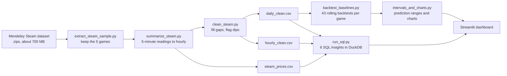
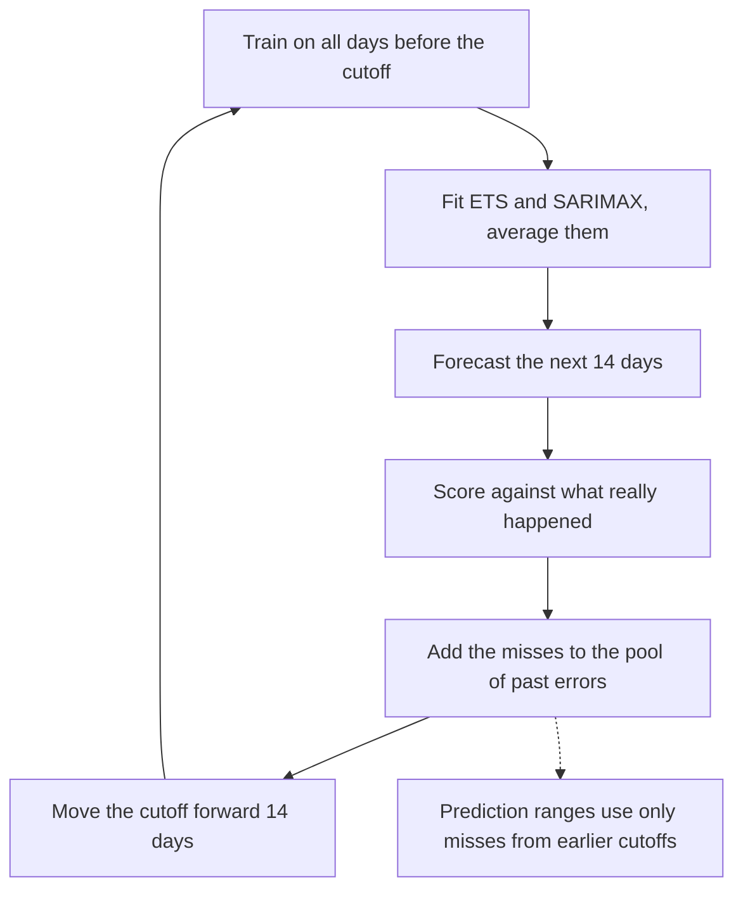
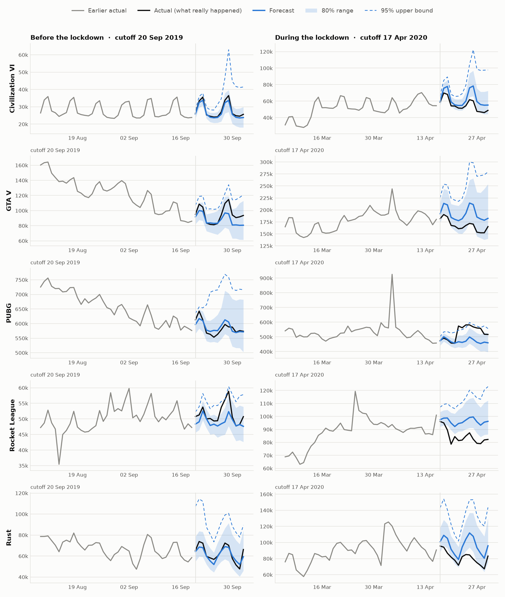
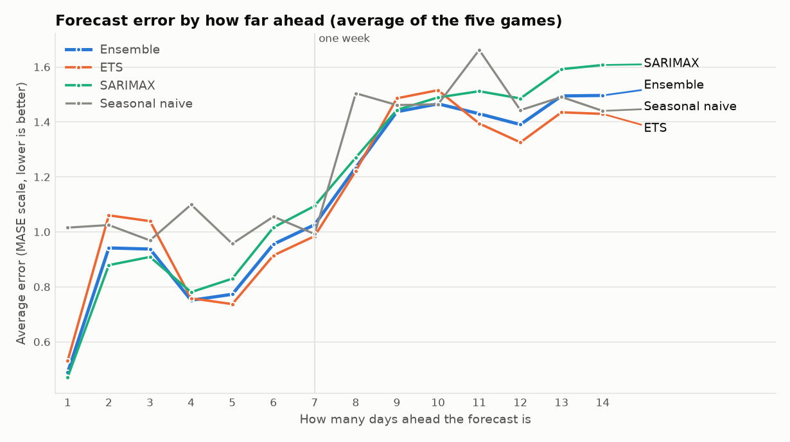

# ChronosGame: forecasting player demand for live-service games

Forecast the **daily peak number of players online** for five real Steam games, 14 days ahead, and turn the uncertainty into a **capacity buffer** a team can plan around. A SQL layer answers the "what happened and why" questions an analyst gets asked, and a Streamlit dashboard ties it together.

**Games:** PUBG, Rust, Rocket League, GTA V, Civilization VI. **Period:** 14 Dec 2017 to 12 Aug 2020 (973 days each).

## The business question

A live-service game has to decide how many servers to hold for the next two weeks.

- Too few servers: queues, crashes and lost players at peak.
- Too many servers: paying for capacity nobody uses.

So the project forecasts the daily peak (the busiest moment, which is what servers must handle, not the average), and gives a range so capacity can be set to a safe level.

## What the project shows

| Question | Answer |
|---|---|
| Do the models beat "repeat last week"? | Yes, by roughly 5-16% (MASE), mostly in the first week. |
| How far ahead can you trust a forecast? | About one week. For days 8-14 the gain over the baseline is small, so treat it as a range. |
| How much spare capacity is needed? | Depends on the game: about 13-21% (Rocket League) up to 26-83% (Civilization VI), usually more in week two (Rust is the exception). |
| What did the March 2020 lockdown do? | Raised peaks sharply for most games and broke every model. |
| Do sales lift player peaks? | No reliable effect in this data (see limitations). |

## How it works



### How one backtest works

Forecasts are tested the way they would be used: only the past is known at the time of each forecast.



## Decisions and why

- **Target is the daily peak.** Servers must cope with the busiest moment, and the average hides it. Concurrent players are not daily active users or revenue, and the project makes no claim about either.
- **Cleaning.** Blank readings and failed readings stored as 0 were rebuilt (about 2% of hours). Gaps of 6 hours or less use a straight line. Longer gaps use the same hour one week earlier and later, which keeps the daily shape. Unusually low hours are flagged but left unchanged, because some are real (PUBG's weekly maintenance).
- **Rolling-origin backtest.** 43 cutoffs per game, a 14-day horizon, 365 days of initial history. One train/test split would mostly measure luck.
- **Models.** Seasonal naive (the benchmark), ETS (damped trend, weekly pattern) and SARIMAX (1,1,1)(1,0,1,7), both on the log scale, plus an ensemble that averages ETS and SARIMAX. The ensemble is not the best on every cutoff, but it is never far from the best and avoids betting on the wrong model.
- **Metrics.** MASE (error relative to a repeat-last-week forecast, comparable across games of different size), sMAPE (typical percent error) and RMSE.
- **Prediction ranges.** Built from the model's own earlier misses (log of actual over forecast), pooled over three neighbouring forecast days, using only cutoffs already known at the time. The 80% range is the 10th to 90th percentile and the 95% upper bound is the capacity level. The first 8 cutoffs have too little history, so ranges cover 35 cutoffs per game.

## Results

Mean MASE over 43 cutoffs (lower is better; below 1 means better than the in-sample weekly baseline):

| Game | Seasonal naive | ETS | SARIMAX | Ensemble | Ensemble sMAPE |
|---|---|---|---|---|---|
| PUBG | 0.542 | 0.485 | 0.484 | **0.478** | 6.0% |
| Rocket League | 1.088 | 0.994 | 1.038 | **0.987** | 6.1% |
| Civilization VI | 1.550 | **1.427** | 1.477 | 1.444 | 10.6% |
| GTA V | 1.759 | **1.473** | 1.632 | 1.524 | 12.2% |
| Rust | 1.339 | 1.275 | 1.218 | **1.217** | 12.2% |

Average error by distance (five games, ensemble vs the baseline): days 1-3 0.79 vs 1.00, days 4-7 0.88 vs 1.03, days 8-14 1.42 vs 1.50.

Capacity buffer (how far the 95% upper bound sits above the point forecast):

| Game | Days 1-7 | Days 8-14 |
|---|---|---|
| Rocket League | 13% | 21% |
| PUBG | 16% | 26% |
| GTA V | 21% | 44% |
| Civilization VI | 26% | 83% |
| Rust | 54% | 47% |

Calibration across all games: the 80% range contains the actual value 81-82% of the time, and the actual goes above the 95% bound on 3.4% of days (target 5%). GTA V and Rocket League are slightly under-covered.




### SQL insights (`sql/insights/`)

| Insight | Finding |
|---|---|
| Lockdown (Mar-Jun 2020 vs 2019) | GTA V +104%, Civilization VI +53%, Rust +48%, Rocket League +37%, PUBG -34% (already shrinking) |
| Weekend vs weekday peak | Civilization VI +33%, Rust +18%, GTA V +16%, PUBG +6%, Rocket League +5% |
| Sales (first 3 days vs 7 days before) | Average change from -3% (Rust) to +10% (GTA V), with wide scatter over 8-15 sales per game |
| Unusual dips | PUBG: 388 flagged hours, concentrated on Wednesday 01:00-06:00 (weekly maintenance) |

Also: monthly trend with month-over-month change, and a 7-day rolling average with week-over-week change.

## Run it

Requires Python 3. The raw data is not in this repository (see Data).

```bash
pip install -r requirements.txt

# 1. extract the five games from the downloaded dataset folders or zips
python src/extract_steam_sample.py data/raw --apps 578080 252490 252950 271590 289070 --out steam_sample
# 2. hourly and price tables
python src/summarize_steam.py steam_sample
# 3. clean
python src/clean_steam.py
# 4. backtest (a few minutes)
python src/backtest_baselines.py
# 5. prediction ranges and charts
python src/intervals_and_charts.py
# 6. SQL insights
python src/run_sql.py
# 7. dashboard
streamlit run src/dashboard.py
```

The dashboard has tabs for the forecast viewer, accuracy, capacity buffers, insights, and data and method. Every forecast shown is a replay: what the model would have said on that date.

## Repository layout

```
src/
  extract_steam_sample.py   pick the five games out of the raw files
  summarize_steam.py        5-minute readings to hourly; price table
  clean_steam.py            rebuild gaps, flag dips; hourly and daily tables
  backtest_baselines.py     rolling-origin backtest of four models
  intervals_and_charts.py   empirical ranges, capacity buffers, charts
  run_sql.py                run sql/insights/*.sql in DuckDB
  dashboard.py              Streamlit app
  dashboard_data.py         data preparation for the app
sql/insights/               six SQL queries (window functions)
reports/figures/            fan charts, error by forecast day
.streamlit/config.toml      theme
```

## Limitations

- **Old and small.** Five games, data ends in August 2020.
- **Concurrent players only.** No revenue, retention or unique players, so no money claims.
- **Lockdown.** A structural break; the naive baseline beat the models for some games after March 2020. No model here anticipates a shock.
- **Wide ranges in week two.** The honest picture of this data, not a bug.
- **Sale analysis is simple.** It compares the first 3 days of a sale with the 7 days before and does not adjust for weekday, so part of a measured lift can be a weekend effect. It is not evidence that sales do or do not work.
- **Lockdown comparison** includes each game's own trend.

## Possible next steps

- Add known-in-advance events (sales, holidays, patches) as model inputs; try Prophet or LightGBM.
- Redo the sale analysis against the same weekdays in earlier weeks.
- Choose the capacity level from outage cost versus server cost instead of a fixed 95%.
- Detect structural breaks and refit faster.
- Refresh with current data.

## Data

Steam Games Dataset: Wannigamage, D., Barlow, M., Lakshika, E., Kasmarik, K. (2020), Mendeley Data, V1, [doi:10.17632/ycy3sy3vj2.1](https://doi.org/10.17632/ycy3sy3vj2.1). Players online at the same moment, sampled every 5 minutes.

The dataset page does not state a licence, so the data is **not** redistributed here (`data/` and `steam_sample/` are git-ignored). Download it from Mendeley, put the extracted folders in `data/raw/`, and follow the steps above.