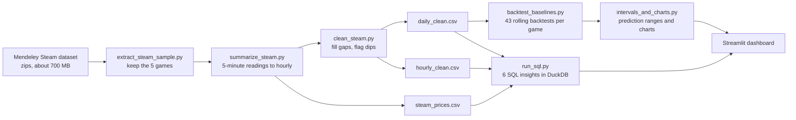
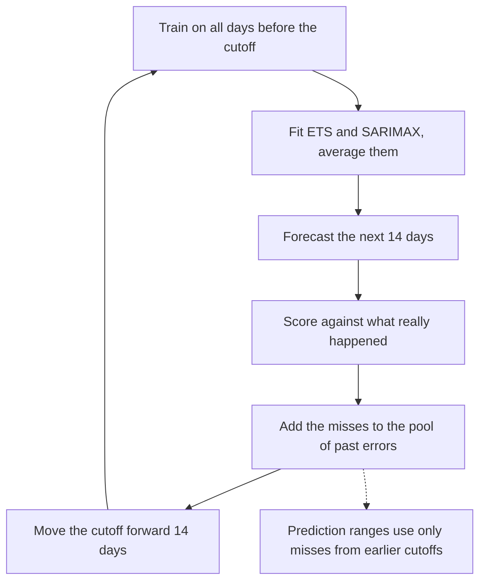
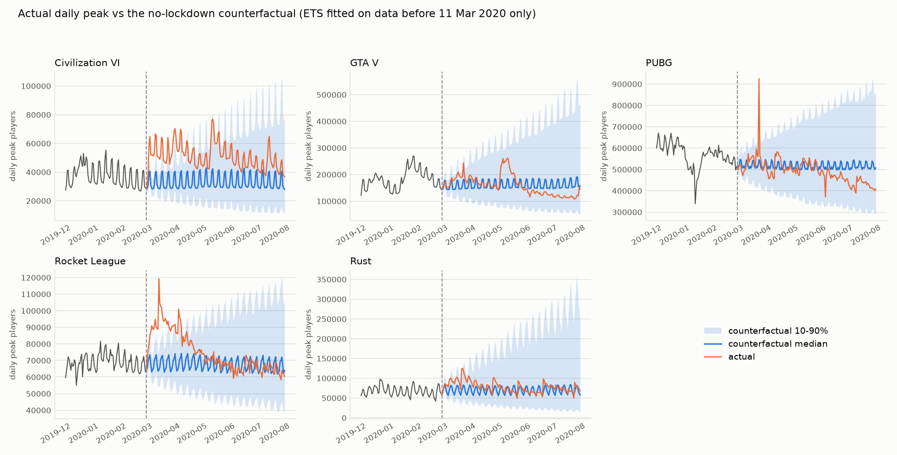
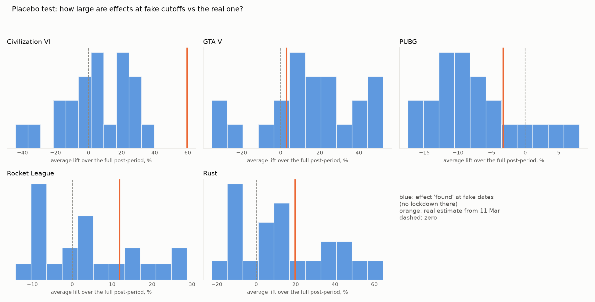
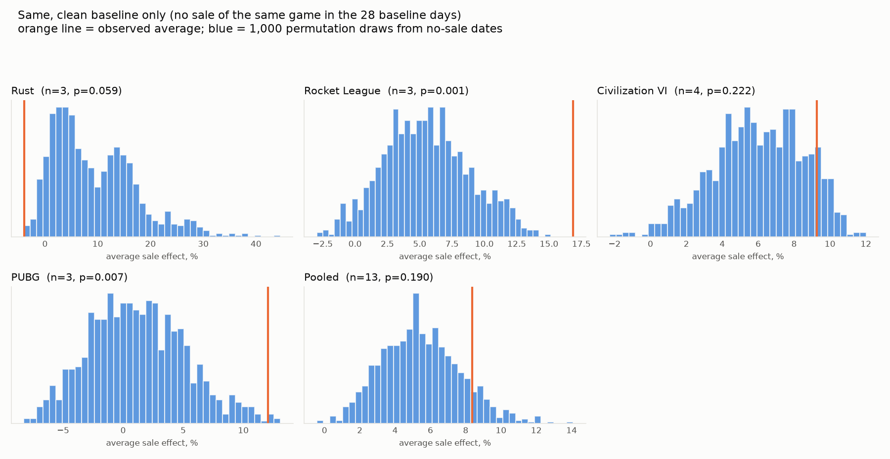

# ChronosGame: forecasting player demand for live-service games

Forecast the **daily peak number of players online** for five real Steam games, 14 days ahead, and turn the uncertainty into a **capacity buffer** a team can plan around. A SQL layer answers the "what happened and why" questions an analyst gets asked, and a Streamlit dashboard ties it together.

**Games:** PUBG, Rust, Rocket League, GTA V, Civilization VI. **Period:** 14 Dec 2017 to 12 Aug 2020 (973 days each).

## The business question

A live-service game has to decide how many servers to hold for the next two weeks.

- Too few servers: queues, crashes and lost players at peak.
- Too many servers: paying for capacity nobody uses.

So the project forecasts the daily peak (the busiest moment, which is what servers must handle, not the average), and gives a range so capacity can be set to a safe level.

## What the project shows

| Question | Answer |
|---|---|
| Do the models beat "repeat last week"? | Yes, by roughly 5-16% (MASE), mostly in the first week. |
| How far ahead can you trust a forecast? | About one week. For days 8-14 the gain over the baseline is small, so treat it as a range. |
| How much spare capacity is needed? | Depends on the game: about 12-18% (Rocket League) up to 23-71% (Civilization VI), usually more in week two (Rust is the exception). |
| What did the March 2020 lockdown do? | Peaks rose for three games (Civilization VI +36%, Rust +14%, Rocket League +10% against Jan-Feb 2020), not for GTA V or PUBG. Forecast errors rose for four of five games (not PUBG). The causal estimate (below) finds a clear short-run lift for Civilization VI, Rocket League and Rust, and none that stands out from noise for GTA V or PUBG. |
| Do sales lift player peaks? | No reliable effect once weekday and other games are controlled for (13 sales with a clean baseline: +8.4% against +5.4% for random dates, p = 0.19). See Causal analysis. |

## How it works



### How one backtest works

Forecasts are tested the way they would be used: only the past is known at the time of each forecast.



## Decisions and why

- **Target is the daily peak.** Servers must cope with the busiest moment, and the average hides it. Concurrent players are not daily active users or revenue, and the project makes no claim about either.
- **Cleaning.** Blank readings and failed readings stored as 0 were rebuilt (about 2% of hours). Gaps of 6 hours or less use a straight line. Longer gaps use the same hour one week earlier and later, which keeps the daily shape. Unusually low hours are flagged but left unchanged, because some are real (PUBG's weekly maintenance).
- **Rolling-origin backtest.** 43 cutoffs per game, a 14-day horizon, 365 days of initial history. One train/test split would mostly measure luck.
- **No leakage.** The training data at each cutoff is rebuilt from raw readings before that cutoff and cleaned using only those readings, because the gap-filling rule looks a week ahead. `tests/test_no_leakage.py` scrambles the future and checks the training series does not move. On this dataset the earlier version already gave identical peak-player training data, so the results did not change; the average-players series moved by at most 0.6% on a day.
- **Models.** Seasonal naive (the benchmark), ETS (damped trend, weekly pattern) and SARIMAX (1,1,1)(1,0,1,7), both on the log scale, plus an ensemble that averages ETS and SARIMAX. The ensemble is not the best on every cutoff, but it is never far from the best and avoids betting on the wrong model.
- **Metrics.** MASE (error relative to a repeat-last-week forecast, comparable across games of different size), sMAPE (typical percent error) and RMSE.
- **Prediction ranges.** Built from the model's own earlier misses (log of actual over forecast), pooled over three neighbouring forecast days, using only cutoffs already known at the time. The 80% range is the 10th to 90th percentile and the 95% upper bound is the capacity level. The first 8 cutoffs have too little history, so ranges cover 35 cutoffs per game.

## Results

Mean MASE over 43 cutoffs (lower is better; below 1 means better than the in-sample weekly baseline):

| Game | Seasonal naive | ETS | SARIMAX | Ensemble | Ensemble sMAPE |
|---|---|---|---|---|---|
| PUBG | 0.542 | 0.485 | 0.484 | **0.478** | 6.0% |
| Rocket League | 1.088 | 0.994 | 1.038 | **0.987** | 6.1% |
| Civilization VI | 1.550 | **1.427** | 1.477 | 1.444 | 10.6% |
| GTA V | 1.759 | **1.473** | 1.632 | 1.524 | 12.2% |
| Rust | 1.339 | 1.275 | 1.218 | **1.217** | 12.2% |

Average error by distance (five games, ensemble vs the baseline): days 1-3 0.79 vs 1.00, days 4-7 0.88 vs 1.03, days 8-14 1.42 vs 1.50.

Capacity buffer (how far the 95% upper bound sits above the point forecast):

| Game | Days 1-7 | Days 8-14 |
|---|---|---|
| Rocket League | 12% | 18% |
| PUBG | 16% | 25% |
| GTA V | 21% | 42% |
| Civilization VI | 23% | 71% |
| Rust | 48% | 45% |

Calibration across all games: the 80% range contains the actual value 79-80% of the time, and the actual goes above the 95% bound on 3.3-3.6% of days (target 5%). GTA V and Rocket League are slightly under-covered: 72-77% inside the 80% range and 5.3-6.1% above the 95% bound.


### SQL insights (`sql/insights/`)

| Insight | Finding |
|---|---|
| Lockdown (Mar-Jun 2020 vs Jan-Feb 2020) | Civilization VI +36%, Rust +14%, Rocket League +10%, PUBG -7%, GTA V -8%. The year-on-year view (GTA V +104%) is misleading: GTA V was already climbing and peaked in Feb 2020 |
| Weekend vs weekday peak | Civilization VI +33%, Rust +18%, GTA V +16%, PUBG +6%, Rocket League +5% |
| Sales (first 3 days vs 7 days before) | Average change from -3% (Rust) to +10% (GTA V), with wide scatter over 8-15 sales per game |
| Unusual dips | PUBG: 388 flagged hours, concentrated on Wednesday 01:00-06:00 (weekly maintenance) |

Also: monthly trend with month-over-month change, and a 7-day rolling average with week-over-week change.

## Causal analysis

Two questions the SQL insights could only answer as "what coincided with what". Both are **estimates from observational data, not proof**, and both are about the daily peak of concurrent players only (nothing about revenue, retention or unique players). Code: `src/causal_lockdown.py`, `src/causal_sales.py`; tests: `tests/test_causal_no_leakage.py`; outputs: `reports/causal_*.csv` and `reports/figures/causal_*.png`; dashboard: the "Causal analysis" tab.

### 1. How much did the March 2020 lockdown change the daily peak?

**Method.** For each game, fit the same ETS as the backtest (damped trend, weekly pattern, log scale) on data before **11 March 2020** only, simulate 1,000 possible no-lockdown futures up to 12 Aug 2020, and compare the actual peaks with each simulated path: lift = average of (actual / counterfactual - 1). The median and the 10-90% range over the paths are reported. The other games are not used as controls, because all five were hit at the same time. The date is a parameter, with two other dates (1 and 23 March) as a sensitivity check.

**Placebo test.** The identical procedure is repeated at 22 fake cutoffs inside the pre-period (every 14 days, 365+ days of history, the same 155-day post-period). No lockdown happened there, so the spread of those "effects" shows how far this method is wrong by itself. The real estimate is judged against that spread, not against zero.

**Assumptions.** (1) Nothing else changed for the game at the same time (patches, price cuts, other releases). (2) Without lockdown the pre-period pattern (level, damped trend, weekly shape) would have continued. The simulated paths include random day-to-day noise but not uncertainty in the fitted parameters, so the 10-90% ranges are too narrow if anything; the placebo spread is the fairer yardstick.

**No leakage.** The model is given only the series from `train_series` (raw readings before the cutoff, cleaned with only those readings). `tests/test_causal_no_leakage.py` scrambles every reading after the cutoff for all five games at the real date, both sensitivity dates and all 22 placebo cutoffs (125 cases) and checks the model input and the simulated paths do not change. It also checks that every placebo window ends before the real intervention, and it builds a gap that the old cleaning would have leaked through, to show the test can fail.

**Results: first 30 days** (average lift, median and 10-90% range; placebo = the 10-90% range of the 22 fake cutoffs)

| Game | Estimated lift | Placebo range | Reading |
|---|---|---|---|
| Civilization VI | +62.5% (25.1 to 108.9) | -18.2 to 26.4 | clearly outside the placebo range |
| Rocket League | +34.4% (17.7 to 55.7) | -7.2 to 10.5 | clearly outside |
| Rust | +33.4% (-5.0 to 98.9) | -10.7 to 20.7 | outside, with a wide range |
| GTA V | +15.0% (-12.0 to 51.9) | -17.5 to 24.4 | inside the placebo range |
| PUBG | +4.4% (-9.0 to 20.0) | -9.8 to 4.4 | at the edge; small |

**Results: longer windows** (median; 10-90% range in brackets)

| Game | 11 Mar - 30 Jun (112 days) | placebo | Full post-period (155 days) | placebo |
|---|---|---|---|---|
| Civilization VI | +64.5% (5.3 to 167.5) | -19.1 to 30.7 | +59.6% (-3.0 to 185.7) | -19.5 to 27.4 |
| Rocket League | +17.1% (-7.3 to 47.9) | -10.3 to 16.6 | +11.9% (-14.3 to 47.1) | -8.9 to 23.7 |
| Rust | +21.0% (-35.9 to 134.4) | -13.8 to 42.8 | +19.7% (-42.1 to 160.9) | -13.5 to 47.7 |
| GTA V | +12.1% (-30.6 to 90.1) | -21.1 to 38.6 | +3.0% (-40.2 to 88.1) | -21.6 to 46.3 |
| PUBG | +0.2% (-21.5 to 30.9) | -13.5 to 3.4 | -3.3% (-28.1 to 32.7) | -14.8 to 1.3 |

Over the longer windows only Civilization VI stands clearly apart from the placebo range (Rocket League is just outside it to 30 June, inside it over the full period). For GTA V, PUBG and Rust the full-period estimate is within what the method produces on its own.




**Sensitivity to the intervention date** (first 30 days, median %)

| Game | 1 Mar | 11 Mar | 23 Mar |
|---|---|---|---|
| Civilization VI | 33.8 | 62.5 | 7.7 |
| Rocket League | 21.0 | 34.4 | 7.2 |
| Rust | 31.9 | 33.4 | 17.3 |
| GTA V | -3.1 | 15.0 | 12.4 |
| PUBG | -3.5 | 4.4 | 6.0 |

Civilization VI, Rocket League and Rust stay positive on all three dates. GTA V and PUBG change sign. A 23 March cutoff trains on 12 days of lockdown, so it is expected to shrink the estimate; the size of the Civilization VI effect still depends a lot on the date.

**Against the SQL numbers.** The year-on-year figures quoted earlier (GTA V +104%, Civilization VI +53%, Rust +48%, Rocket League +37%, PUBG -34%) compare Mar-Jun 2020 with Mar-Jun 2019. They mix lockdown with each game's own growth or decline between the two years. The Jan-Feb 2020 baseline and the counterfactual estimate remove most of that:

| Game | SQL vs Mar-Jun 2019 | SQL vs Jan-Feb 2020 | Counterfactual, 11 Mar - 30 Jun | Actual vs last 30 pre-lockdown days | Model expected vs last 30 days |
|---|---|---|---|---|---|
| Civilization VI | +52.8% | +35.7% | +64.5% | +58.9% | +2.0% |
| GTA V | +104.2% | -8.4% | +12.1% | -9.8% | -14.9% |
| PUBG | -33.9% | -7.3% | +0.2% | -8.1% | -7.0% |
| Rocket League | +36.5% | +10.4% | +17.1% | +16.3% | +1.2% |
| Rust | +47.9% | +14.4% | +21.0% | +21.6% | +11.4% |

PUBG is the clearest case: its players were already falling, the model expected a drop of about 7% from the last pre-lockdown month and the actual drop was 8.1%, so the estimated lockdown effect is about zero. The -34% year-on-year figure is mostly that existing decline. GTA V had peaked in February 2020 and the model expected a further fall (-14.9%); the actual fall was smaller (-9.8%), which is where the +12% comes from, with a range from -31% to +90%.

### 2. Do Steam sales lift the daily peak?

**Method.** For a sale start, the lift is the average over its first 3 days of log(peak that day) - the average log(peak on the same weekday in each of the 4 previous weeks), which removes the weekday effect that the SQL comparison has. The same number is computed for the other games that have no discount on those 3 days (the control) and subtracted (difference-in-differences). A sale with no control game is skipped: **14 of 53 sale starts were skipped** (every other game was on sale in the same 3 days, as in the big seasonal sales), leaving 39. Permutation test: the same statistic is computed for random start dates on which no game is on sale, with the same number of dates as the game has sales, 1,000 repeats with fixed seeds. The p-value is two-sided, with +1 so it is never zero.

**Placebo dates.** At least 7 days from any sale of any game, with price data present, and outside March-June 2020. Only **55** dates qualify, in just 3 separate stretches (late May to mid June 2019, September 2019, mid-late February 2020).

| | Sales | README figure (unadjusted) | Weekday-adjusted | With controls (DiD) | Random-date average | p |
|---|---|---|---|---|---|---|
| Pooled | 39 | +6.2% | +2.9% | +8.0% | -1.4% | 0.001 |
| Civilization VI | 12 | +2.0% | +1.1% | +5.8% | -3.5% | 0.001 |
| GTA V | 10 | +13.1% | +0.5% | +6.4% | -7.2% | 0.001 |
| PUBG | 6 | +9.7% | +3.4% | +9.3% | +1.1% | 0.004 |
| Rocket League | 5 | +11.3% | +17.2% | +24.2% | +3.0% | 0.001 |
| Rust | 6 | -4.5% | -0.9% | +1.2% | +7.4% | 0.18 |

(The unadjusted column covers the same 39 sales; across all 53 sales it runs from -3.4% for Rust to +10.0% for GTA V, as in the SQL table.) Weekday adjustment removes almost all of GTA V's apparent +13%.

**These p-values should not be trusted.** The random-date average is not near zero for GTA V (-7.2%), Civilization VI (-3.5%) and Rust (+7.4%), because most placebo dates sit shortly after a sale of the same game, so the 4-week baseline is inflated (93% of GTA V's placebo dates, against 5 of 10 of its real sales). The comparison is therefore biased, and with 3 stretches of dates the draws are far from independent. The fairer version requires that the same game had no sale in the 28 baseline days, for both real sales and placebo dates (GTA V drops out: too few clean placebo dates):

| Clean baseline | Sales | DiD | Random-date average (10-90%) | p |
|---|---|---|---|---|
| Pooled | 13 | +8.4% | +5.4% (2.7 to 8.4) | 0.19 |
| Civilization VI | 4 | +9.3% | +6.0% | 0.22 |
| Rust | 3 | -3.9% | +9.1% | 0.06 |
| PUBG | 3 | +12.1% | +1.1% | 0.007 |
| Rocket League | 3 | +16.9% | +5.5% | 0.001 |

**Conclusion.** Pooled, a sale lift is **not reliably detectable**: after the fix the observed +8.4% sits inside the range random no-sale dates produce (+5.4% on average, p = 0.19). Rocket League and PUBG look positive, but on 3 sales each and 3 stretches of placebo dates, so treat that as a lead, not a finding. Dropping the March-June 2020 sales does not change the picture (pooled DiD +10.8%, 26 sales, same bias problem).



### Limitations of the causal analysis

- **Observational.** Neither lockdown nor sales were randomised. "Estimated effect" means this method's best estimate under the stated assumptions.
- **One simultaneous shock is known.** Civilization VI had a 75% sale starting 12 March 2020, one day after the intervention date; the sale analysis puts that sale at about +25% (weekday-adjusted), so part of Civilization VI's +62.5% may be the sale, not lockdown. Other patches or events are not modelled.
- **Placebo bias over long horizons.** The average placebo effect over the full post-period is +15.1% (GTA V), +14.9% (Rust) and -7.4% (PUBG): ETS misses long-run drift. Over 30 days it is between -1.7% and +5.7%, which is why the 30-day numbers are the headline.
- **Ranges.** The simulated ranges leave out parameter uncertainty and are wide (Civilization VI to 30 June: +5% to +168%). The 22 placebo cutoffs overlap, so "no placebo as extreme" means none of 22 overlapping windows, not a formal p-value.
- **Date dependence.** The Civilization VI estimate moves from +7.7% to +62.5% across the three dates.
- **Sales.** Few events (3 to 12 per game), only 55 usable placebo dates in 3 stretches, a 28-day baseline that earlier sales contaminate, and sales that were mostly seasonal events shared by all games, which is why 14 had no control.
- **Scope.** Concurrent players only; no revenue, conversion, retention or unique players.

## Run it

Requires Python 3. The raw data is not in this repository (see Data).

```bash
pip install -r requirements.txt

# 1. extract the five games from the downloaded dataset folders or zips
python src/extract_steam_sample.py data/raw --apps 578080 252490 252950 271590 289070 --out steam_sample
# 2. hourly and price tables
python src/summarize_steam.py steam_sample
# 3. clean
python src/clean_steam.py
# 4. backtest (a few minutes)
python src/backtest_baselines.py
# (optional) check the backtest never sees the future
python tests/test_no_leakage.py
# 5. prediction ranges and charts
python src/intervals_and_charts.py
# 6. SQL insights
python src/run_sql.py
# 7. causal analysis (needs statsmodels; a few minutes)
python tests/test_causal_no_leakage.py
python src/causal_lockdown.py
python src/causal_sales.py
# 8. dashboard
streamlit run src/dashboard.py
```

The dashboard has tabs for the forecast viewer, accuracy, capacity buffers, insights, causal analysis, and data and method. Every forecast shown is a replay: what the model would have said on that date.

## Repository layout

```
src/
  extract_steam_sample.py   pick the five games out of the raw files
  summarize_steam.py        5-minute readings to hourly; price table
  clean_steam.py            rebuild gaps, flag dips; hourly and daily tables
  backtest_baselines.py     rolling-origin backtest of four models
  intervals_and_charts.py   empirical ranges, capacity buffers, charts
  causal_lockdown.py        counterfactual forecast + placebo test for March 2020
  causal_sales.py           weekday-adjusted sale effect, controls, permutation test
  metrics.py                MASE, sMAPE, RMSE and the other metrics
  run_sql.py                run sql/insights/*.sql in DuckDB
  dashboard.py              Streamlit app
  dashboard_data.py         data preparation for the app
  dashboard_causal.py       the Causal analysis tab
sql/insights/               six SQL queries (window functions)
tests/test_no_leakage.py     checks no training data comes from after its cutoff
tests/test_causal_no_leakage.py  same check for the counterfactual model and placebo windows
tests/test_metrics.py        unit tests for metrics.py
reports/causal_*.csv        causal results tables
reports/figures/            fan charts, error by forecast day
.streamlit/config.toml      theme
```

## Limitations

- **Old and small.** Five games, data ends in August 2020.
- **Concurrent players only.** No revenue, retention or unique players, so no money claims.
- **Lockdown.** A structural break; the naive baseline beat the models for some games after March 2020. No model here anticipates a shock.
- **Wide ranges in week two.** The honest picture of this data, not a bug.
- **Sale analysis has little power.** After adjusting for weekday and other games, 13 sales with a clean baseline show +8.4% against +5.4% for random dates (p = 0.19). The permutation test has only 55 placebo dates in 3 stretches. It is not evidence that sales do or do not work.
- **Lockdown estimates are model-based.** The counterfactual assumes the pre-2020 pattern would have continued and that nothing else changed at the same time. The estimates are clear for Civilization VI, Rocket League and Rust in the first 30 days only, depend on the intervention date, and for Civilization VI overlap with a sale starting 12 March 2020. See Causal analysis.

## Possible next steps

- Add known-in-advance events (sales, holidays, patches) as model inputs; try Prophet or LightGBM.
- Put parameter uncertainty into the counterfactual (bootstrap or refit), and test a longer-memory model that handles drift better.
- Remove the Civilization VI sale overlap (estimate lockdown with sale days masked) and add patch and update dates as known events.
- Redo the sale test with a longer price history so there are more usable sales and placebo dates.
- Choose the capacity level from outage cost versus server cost instead of a fixed 95%.
- Detect structural breaks and refit faster.
- Refresh with current data.

## Data

Steam Games Dataset: Wannigamage, D., Barlow, M., Lakshika, E., Kasmarik, K. (2020), Mendeley Data, V1, [doi:10.17632/ycy3sy3vj2.1](https://doi.org/10.17632/ycy3sy3vj2.1). Players online at the same moment, sampled every 5 minutes.

The dataset page does not state a licence, so the data is **not** redistributed here (`data/` and `steam_sample/` are git-ignored). Download it from Mendeley, put the extracted folders in `data/raw/`, and follow the steps above.